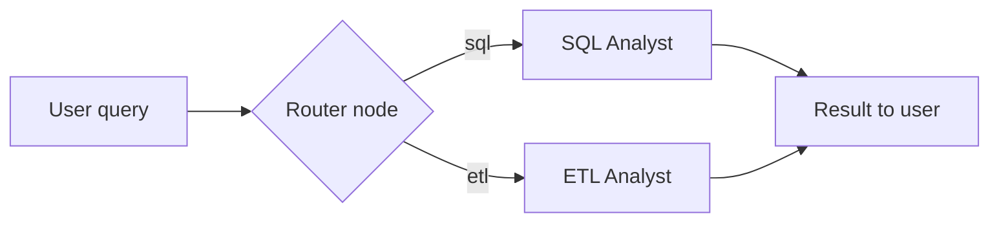
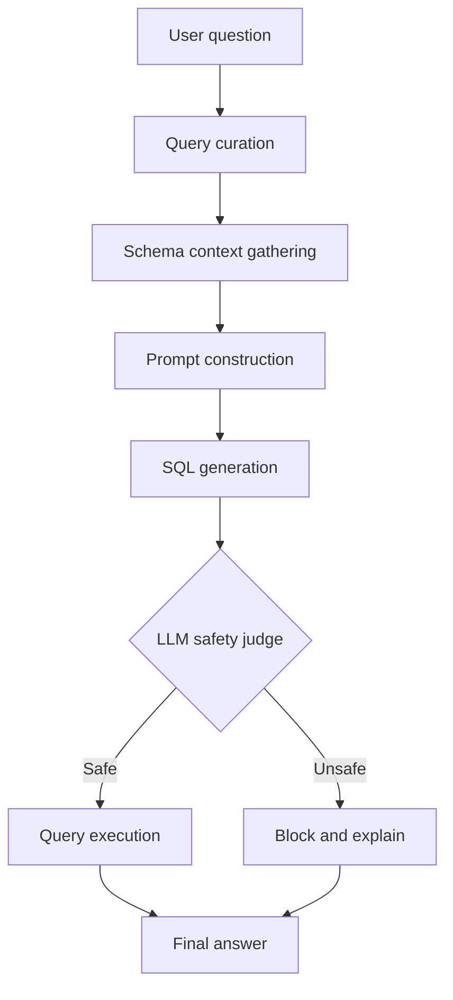
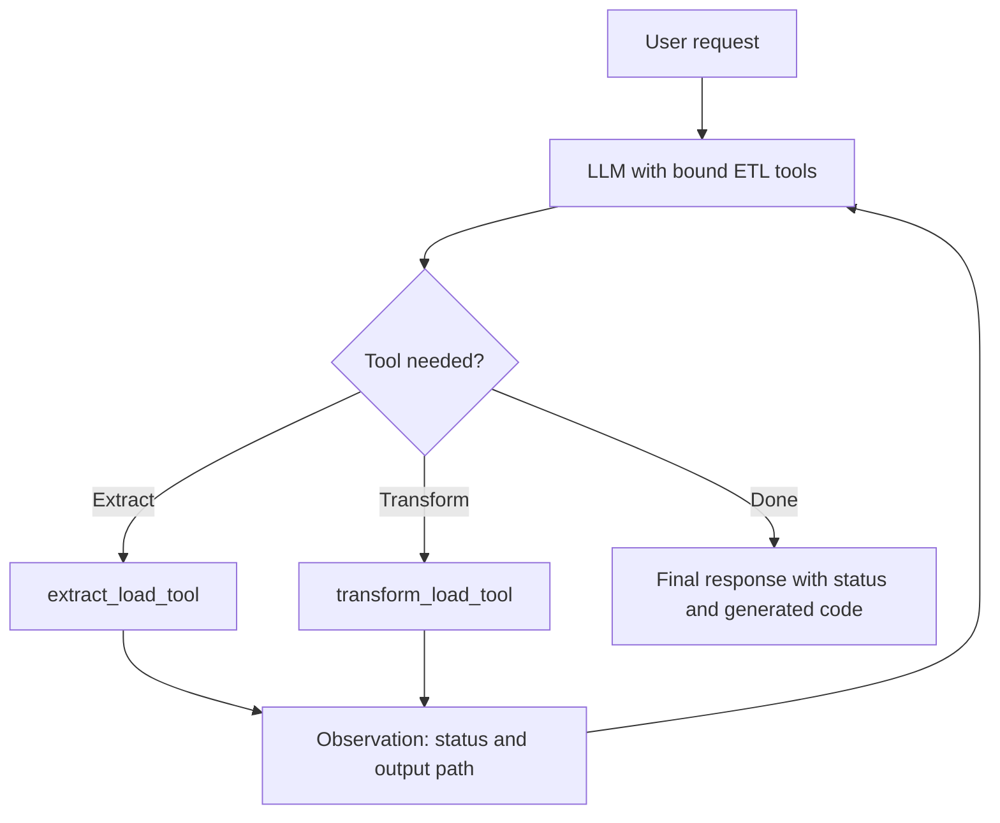

<!-- # 🤖 Agentic AI - Data Agent

An intelligent, multi-agent system built with **LangGraph** that processes natural language queries by routing them to specialized agents for **SQL database analytics** or **ETL workflows** using locally-hosted LLMs via **Ollama**.

[](https://www.python.org/)
[](https://langchain-ai.github.io/langgraph/)
[](https://ollama.com/)
[](LICENSE)

---

## 🏗️ System Architecture

```
                   ┌─────────────────────────┐
                   │   Data Agent (Router)   │
                   └────────────┬────────────┘
                                │
              ┌─────────────────┴─────────────────┐
              ▼                                   ▼
    ┌──────────────────┐                ┌──────────────────┐
    │  SQL Analyst     │                │   ETL Analyst    │
    └─────────┬────────┘                └─────────┬────────┘
              │                                   │
              ├─► Context & Schema Gathering      ├─► API Data Extraction
              ├─► SQL Generation & Safety Judge   ├─► Pandas Transformations
              └─► Query Execution & Answers       └─► Code Execution & Output
```

---

## ✨ Core Features

* **Intelligent Intent Routing:** Automatically analyzes user intent and routes queries to either the SQL or ETL pipeline.
* **SQL Analyst Agent:** Converts natural language to Postgres queries, inspects live database schema context, validates query safety with an AI safety judge (blocking destructive operations like `DROP`, `DELETE`, `UPDATE`), and returns friendly answers.
* **ETL Analyst Agent:** Extracts data from REST APIs into CSV/JSON/Parquet, loads sample data context, generates Pandas transformation code dynamically, and executes the transformation locally.
* **Local AI Model Tiering:** Routes requests across distinct local model tiers (`low`, `medium`, `high`) powered by a local Ollama instance for zero-cost, private, offline execution.

---

## ⚙️ Prerequisites

Before getting started, make sure you have the following installed on your machine:

1. **Python 3.11+**
2. **[uv](https://github.com/astral-sh/uv)** (recommended fast Python package manager) or standard `pip`
3. **[Ollama](https://ollama.com/)** (to run local LLMs)
4. **PostgreSQL** instance running locally or remotely

---

## 📥 Cloning & Installation Guide

### 1. Clone the Repository

```bash
git clone https://github.com/your-username/Data_Agent.git
cd Data_Agent
```

### 2. Setup Virtual Environment & Dependencies

#### Option A: Using `uv` (Recommended)
```bash
# Automatically creates virtual environment (.venv) and syncs dependencies
uv sync

# Activate the virtual environment
source .venv/bin/activate       # macOS / Linux
# or: .\.venv\Scripts\activate  # Windows
```

#### Option B: Using standard `venv` & `pip`
```bash
python3 -m venv .venv
source .venv/bin/activate       # macOS / Linux
# or: .\.venv\Scripts\activate  # Windows

pip install -e .
```

---

## 🧠 Establishing Local AI Model APIs (Ollama)

This project runs **100% locally** using Ollama for model serving. Follow these steps to establish the AI model APIs:

### 1. Install & Launch Ollama

* **macOS:**
  ```bash
  brew install ollama
  ollama serve
  ```
  *(Or download the macOS App directly from [ollama.com](https://ollama.com/download))*
* **Linux:**
  ```bash
  curl -fsSL https://ollama.com/install.sh | sh
  ```
* **Windows:** Download the installer from [ollama.com](https://ollama.com/download/windows).

Make sure Ollama is running in the background. By default, it serves its API on `http://127.0.0.1:11434`.

### 2. Pull the Required Models

The agent uses three tiers defined in `utils/llm_pick.py`:

| Tier | Purpose | Recommended Model | Pull Command |
| :--- | :--- | :--- | :--- |
| **Low** | Quick routing, query curation, formatting | `qwen2.5-coder:1.5b` | `ollama pull qwen2.5-coder:1.5b` |
| **Medium** | SQL generation, safety judge, Pandas code | `qwen2.5-coder:7b` | `ollama pull qwen2.5-coder:7b` |
| **High** | Complex multi-step reasoning | `qwen2.5-coder:14b` or `llama3.1:8b` | `ollama pull qwen2.5-coder:14b` |

> [!IMPORTANT]
> **Use Chat/Instruct models, not `-base` models:**
> Always use instruct-tuned models (e.g. `qwen2.5-coder:1.5b`), never foundational `-base` models (e.g. `qwen2.5-coder:1.5b-base`). Base models do not know chat end-of-turn tokens and will ramble endlessly, causing terminal requests to hang.

### 3. Verify the Ollama API

Verify that your local Ollama API is active and models are available:

```bash
curl http://127.0.0.1:11434/api/tags
```

---

## 🗄️ Database Setup (PostgreSQL)

Ensure PostgreSQL is running locally and that you have a database created:

```bash
# Start PostgreSQL (macOS Homebrew example)
brew services start postgresql@16

# Create database if not already existing
createdb postgres
```

---

## 🔑 Environment Configuration (`.env`)

Create a `.env` file in the project root by copying `.env.example`:

```bash
cp .env.example .env
```

Edit `.env` to match your local setup:

```env
# Ollama Local Model Configuration
MODEL_LOW=qwen2.5-coder:1.5b
MODEL_MEDIUM=qwen2.5-coder:7b
MODEL_HIGH=qwen2.5-coder:14b
API_HOST=127.0.0.1
API_PORT=11434

# PostgreSQL Database Connection
host=localhost
port=5432
user=yashgupta
password=root
database=postgres
```

---

## 💻 Usage & Execution

### 1. Run the Full Multi-Agent System

Execute the main entry point:

```bash
python -u main.py
```

The system will:
1. Receive your natural language query.
2. Route it via the **Data Agent Router** to the appropriate sub-agent (`SQL Analyst` or `ETL Analyst`).
3. Display real-time console feedback as tools and LLMs execute.
4. Print the final curated response.

### 2. Run Individual Sub-Agents Directly

You can also run sub-agents independently for testing:

```bash
# Test the SQL Analyst agent
python agents/sql_analyst.py

# Test the ETL Analyst agent
python agents/etl_analyst.py
```

---

## 📁 Repository Structure

```
Data_Agent/
├── agents/             # LangGraph agent definitions
│   ├── data_agent.py   # Master router agent orchestrating sub-agents
│   ├── sql_analyst.py  # SQL generation, security judge, and DB executor
│   └── etl_analyst.py  # Tool-calling agent for extraction and Pandas ETL
├── models/             # Pydantic schemas and LangGraph state definitions
│   └── schema.py       # AgentSchema, JudgeSchema, ETLAgentSchema, etc.
├── utils/              # Shared helper modules
│   ├── database.py     # PostgreSQL connection & schema discovery driver
│   ├── etl_tools.py    # API fetcher and isolated Pandas code executor
│   └── llm_pick.py     # Multi-tier local Ollama model loader
├── data/               # Local workspace for ETL runs
│   ├── extract/        # Target folder for extracted API datasets
│   └── transform/      # Target folder for transformed datasets
├── main.py             # Top-level entry point script
├── pyproject.toml      # Project metadata & dependencies (uv / pip)
├── .env.example        # Environment variable template
└── README.md           # Documentation
```

---

## 🛡️ Security & Guardrails

* **SQL Judge Guardrail:** Every generated SQL query is inspected by an independent LLM judge before execution. Queries containing data manipulation commands (`INSERT`, `UPDATE`, `DELETE`, `DROP`, `ALTER`, `TRUNCATE`) are blocked immediately.
* **Safe Code Execution Context:** The ETL analyst executes Pandas code within an isolated global scope with required modules pre-loaded (`pd`, `os`), raising errors if unexpected operations occur. -->


# 🤖 Agentic AI - Data Agent

An intelligent multi-agent system built with **LangGraph** that processes natural language requests by routing them to specialized agents for **SQL database analytics** or **ETL workflows** (API extraction and Pandas transformations). All LLMs run **locally through Ollama**, so your schema, queries and data stay on your machine.

[](https://www.python.org/)
[](https://langchain-ai.github.io/langgraph/)
[](https://ollama.com/)
[](https://www.postgresql.org/)
[](https://pandas.pydata.org/)
[](LICENSE)

> 🎥 **Video walkthrough:** [Watch the YouTube tutorial](Coming Soon..!!)

---

## Table of Contents

- [Overview](#overview)
- [System Architecture](#system-architecture)
- [Core Features](#core-features)
- [Prerequisites](#prerequisites)
- [Installation](#installation)
- [Local Models with Ollama](#local-models-with-ollama)
- [Database Setup](#database-setup)
- [Environment Configuration](#environment-configuration)
- [Usage](#usage)
- [Examples](#examples)
- [Repository Structure](#repository-structure)
- [Agent Descriptions](#agent-descriptions)
- [Data Models](#data-models)
- [Security and Guardrails](#security-and-guardrails)
- [Development](#development)
- [Troubleshooting](#troubleshooting)
- [Roadmap](#roadmap)
- [Contributing](#contributing)
- [License](#license)
- [Learning Resources](#learning-resources)

---

## Overview

**Data Agent** is a hierarchical agent system. A top-level **router agent** reads a natural language request, works out what the user wants, and hands it to one of two specialists:

| Sub-agent | Handles | Approach |
|-----------|---------|----------|
| **SQL Analyst** | Questions about data stored in PostgreSQL | Fixed multi-step workflow: curate → schema → generate → judge → execute → answer |
| **ETL Analyst** | Extracting data from APIs and transforming datasets | **ReAct-style tool-calling agent**: the LLM reasons, calls an ETL tool, observes the result, and repeats until done |

The project demonstrates modern AI engineering practices:

- Multi-agent orchestration with **LangGraph**
- Intent routing using structured (Pydantic) outputs
- Both a deterministic workflow agent (SQL) and a tool-using ReAct agent (ETL)
- An independent **LLM safety judge** that reviews SQL before it touches the database
- **Local, private, zero-cost inference** with Ollama and tiered model selection

---

## System Architecture

```
                   ┌─────────────────────────┐
                   │   Data Agent (Router)   │
                   └────────────┬────────────┘
                                │
              ┌─────────────────┴─────────────────┐
              ▼                                   ▼
    ┌──────────────────┐                ┌──────────────────┐
    │   SQL Analyst    │                │   ETL Analyst    │
    └─────────┬────────┘                └─────────┬────────┘
              │                                   │
              ├─► Context & Schema Gathering      ├─► API Data Extraction
              ├─► SQL Generation & Safety Judge   ├─► Pandas Transformations
              └─► Query Execution & Answers       └─► Code Execution & Output

                     ▲ every agent calls local LLMs ▲
                 ┌────────────────────────────────────┐
                 │  Ollama · low · medium · high      │
                 └────────────────────────────────────┘
```

### Routing flow



1. **User input**: a natural language request
2. **Router node**: classifies the request as `sql` or `etl` (structured output)
3. **Agent dispatch**: the matching sub-agent takes over
4. **Processing**: the sub-agent completes the task using a local model
5. **Output**: the final response is printed to the user

---

## Core Features

- **Intelligent intent routing**: analyzes the request and routes it to the SQL or ETL pipeline.

- **SQL Analyst agent**
  - Converts natural language to PostgreSQL queries
  - Inspects the live database schema for context
  - Validates every query with an AI **safety judge**, blocking destructive operations such as `DROP`, `DELETE` and `UPDATE`
  - Returns friendly, readable answers

- **ETL Analyst agent (ReAct + tools)**
  - Extracts data from REST APIs into CSV, JSON or Parquet
  - Loads sample data context so the LLM knows the dataset's columns
  - Generates Pandas transformation code dynamically
  - Executes the transformation locally and reports the outcome

- **Local model tiering**: routes work across `low`, `medium` and `high` Ollama models for private, offline, zero-cost execution.

---

## Prerequisites

1. **Python 3.11+**
2. **[uv](https://github.com/astral-sh/uv)** (recommended, fast package manager) or standard `pip`
3. **[Ollama](https://ollama.com/)** to run local LLMs
4. **PostgreSQL** running locally or remotely

---

## Installation

### 1. Clone the repository

```bash
git clone https://github.com/your-username/Data_Agent.git
cd Data_Agent
```

### 2. Set up the virtual environment and dependencies

**Option A: `uv` (recommended)**

```bash
# Creates the virtual environment (.venv) and syncs dependencies
uv sync

# Activate it
source .venv/bin/activate        # macOS / Linux
# .\.venv\Scripts\activate       # Windows
```

**Option B: `venv` and `pip`**

```bash
python3 -m venv .venv
source .venv/bin/activate        # macOS / Linux
# .\.venv\Scripts\activate       # Windows

pip install -e .
```

Dependencies are declared in `pyproject.toml`.

---

## Local Models with Ollama

This project runs **100% locally** using [Ollama](https://ollama.com/) for model serving.

### 1. Install and launch Ollama

- **macOS**
  ```bash
  brew install ollama
  ollama serve
  ```
  *(or download the app from [ollama.com](https://ollama.com/download))*
- **Linux**
  ```bash
  curl -fsSL https://ollama.com/install.sh | sh
  ```
- **Windows:** download the installer from [ollama.com](https://ollama.com/download/windows).

Make sure Ollama is running in the background. By default it serves its API on `http://127.0.0.1:11434`.

### 2. Pull the models

The agents use three tiers, selected in `utils/llm_pick.py`:

| Tier | Purpose | Recommended model | Pull command |
|------|---------|-------------------|--------------|
| **Low** | Quick routing, query curation, formatting | `qwen2.5-coder:1.5b` | `ollama pull qwen2.5-coder:1.5b` |
| **Medium** | SQL generation, safety judge, Pandas code | `qwen2.5-coder:7b` | `ollama pull qwen2.5-coder:7b` |
| **High** | Complex multi-step reasoning | `qwen2.5-coder:14b` or `llama3.1:8b` | `ollama pull qwen2.5-coder:14b` |

> [!IMPORTANT]
> **Use chat/instruct models, not `-base` models.**
> Always use instruct-tuned models (for example `qwen2.5-coder:1.5b`), never foundational `-base` models (for example `qwen2.5-coder:1.5b-base`). Base models don't know the chat end-of-turn tokens and will ramble endlessly, which makes requests hang.

### 3. Verify the Ollama API

```bash
curl http://127.0.0.1:11434/api/tags
ollama list
```

### Using different models

1. Pull the model: `ollama pull <model-name>`
2. Set the matching variable in `.env` (for example `MODEL_HIGH=<model-name>`)
3. Restart the app

**Tips for local models**

- Smaller models are faster but less reliable at following instructions, producing valid structured output (router and safety judge) and calling tools (ETL agent). If a step misbehaves, point that tier at a larger model.
- ReAct tool calling needs a model that supports tools in Ollama.
- The first request after startup is slower because Ollama loads the model into memory.
- Speed depends on your CPU, GPU and RAM.

---

## Database Setup

Make sure PostgreSQL is running and that the database named in your `.env` exists.

```bash
# Start PostgreSQL (macOS Homebrew example)
brew services start postgresql@16
```

PostgreSQL ships with a default `postgres` database, which is what the example `.env` uses. To use a dedicated database instead, create it and update `database` in `.env`:

```bash
createdb my_database
```

The SQL Analyst works with whatever tables exist in the connected database's `public` schema.

---

## Environment Configuration

Create a `.env` file in the project root by copying the template:

```bash
cp .env.example .env
```

Then edit it to match your setup:

```env
# Ollama local model configuration
MODEL_LOW=qwen2.5-coder:1.5b
MODEL_MEDIUM=qwen2.5-coder:7b
MODEL_HIGH=qwen2.5-coder:14b
API_HOST=127.0.0.1
API_PORT=11434

# PostgreSQL database connection
host=localhost
port=5432
user=your_username
password=your_password
database=postgres
```

> ⚠️ Replace `user` and `password` with your own PostgreSQL credentials. Never commit your `.env` file; make sure it is listed in `.gitignore`.

| Variable | Description | Example |
|----------|-------------|---------|
| `MODEL_LOW` | Ollama model for low-complexity tasks | `qwen2.5-coder:1.5b` |
| `MODEL_MEDIUM` | Ollama model for medium-complexity tasks | `qwen2.5-coder:7b` |
| `MODEL_HIGH` | Ollama model for high-complexity tasks | `qwen2.5-coder:14b` |
| `API_HOST` | Host where the Ollama server is running | `127.0.0.1` |
| `API_PORT` | Port of the Ollama server | `11434` |
| `host` | PostgreSQL host | `localhost` |
| `port` | PostgreSQL port | `5432` |
| `user` | PostgreSQL user | `your_username` |
| `password` | PostgreSQL password | `your_password` |
| `database` | PostgreSQL database name | `postgres` |

> `API_HOST` / `API_PORT` refer to the **Ollama** server, while `host` / `port` refer to **PostgreSQL**.

### LLM selection (`utils/llm_pick.py`)

```python
from utils.llm_pick import pick_llm

llm_fast     = pick_llm("low")      # MODEL_LOW
llm_balanced = pick_llm("medium")   # MODEL_MEDIUM
llm_powerful = pick_llm("high")     # MODEL_HIGH
```

Edit this file to change which model handles each tier, temperature, context size, or response format.

---

## Usage

### Run the full multi-agent system

```bash
python -u main.py
```

The system will:

1. Receive your natural language query
2. Route it through the **Data Agent Router** to the right sub-agent (SQL Analyst or ETL Analyst)
3. Show real-time console feedback as tools and LLMs run
4. Print the final response

### Run from Python

```python
from agents.data_agent import data_agent
from langchain_core.messages import HumanMessage

# Database question  →  routed to the SQL Analyst
sql_response = data_agent.invoke({
    "messages": [HumanMessage(content="List all tables in the database")],
    "route_response": ""
})

# API extraction  →  routed to the ETL Analyst
etl_response = data_agent.invoke({
    "messages": [HumanMessage(content="""
        Extract the data from the API endpoint
        'https://pokeapi.co/api/v2/pokemon' and save it to
        data/extract folder in CSV format
    """)],
    "route_response": ""
})

print(sql_response)
```

### Run individual sub-agents

Useful for testing each agent on its own:

```bash
python agents/sql_analyst.py
python agents/etl_analyst.py
```

---

## Examples

### Example 1: Database question (SQL Analyst)

*Illustrative: assumes your database has a `rides` table with `vehicle_type` and `rating` columns.*

**User query**

```
Show me the average rating for each vehicle type
```

**Processing**

1. Router classifies the request as `sql`
2. SQL Analyst fetches the schema
3. Generates:
   ```sql
   SELECT vehicle_type, AVG(rating) FROM rides GROUP BY vehicle_type LIMIT 10;
   ```
4. The safety judge approves the query ✅
5. The query executes and the result is returned as a readable answer

---

### Example 2: Data extraction (ETL Analyst)

**User query**

```
Extract the data from 'https://pokeapi.co/api/v2/pokemon' and save it as CSV
```

**Processing**

1. Router classifies the request as `etl`
2. The ETL agent selects `extract_load_tool`
3. The tool calls the API endpoint
4. The JSON response is normalized into a table
5. The result is saved to `data/extract/extracted_data.csv`

---

### Example 3: Data transformation (ETL Analyst)

**User query**

```
Take the CSV in data/extract, keep only the first 5 rows, and save it as JSON
```

**Processing**

1. Router classifies the request as `etl`
2. The ETL agent selects `transform_load_tool`
3. A sample of the dataset is loaded so the LLM can see the columns
4. Pandas code is generated for the transformation
5. The code is executed locally
6. The result is saved to `data/transform/` in JSON format
7. The agent reports the status along with the generated code

---

### Example 4: Blocked request

**User query**

```
Drop the users table
```

**Result:** ❌ The safety judge flags the query as destructive and nothing is executed.

---

## Repository Structure

```
Data_Agent/
├── agents/             # LangGraph agent definitions
│   ├── data_agent.py   # Master router agent orchestrating sub-agents
│   ├── sql_analyst.py  # SQL generation, safety judge, and DB executor
│   └── etl_analyst.py  # Tool-calling agent for extraction and Pandas ETL
├── models/             # Pydantic schemas and LangGraph state definitions
│   └── schema.py       # AgentSchema, JudgeSchema, ETLAgentSchema, etc.
├── utils/              # Shared helper modules
│   ├── database.py     # PostgreSQL connection and schema discovery driver
│   ├── etl_tools.py    # API fetcher and isolated Pandas code executor
│   └── llm_pick.py     # Multi-tier local Ollama model loader
├── data/               # Local workspace for ETL runs
│   ├── extract/        # Target folder for extracted API datasets
│   └── transform/      # Target folder for transformed datasets
├── main.py             # Top-level entry point script
├── pyproject.toml      # Project metadata and dependencies (uv / pip)
├── .env.example        # Environment variable template
└── README.md           # Documentation
```

---

## Agent Descriptions

### 1. Data Agent (main router)

**File:** `agents/data_agent.py`

**Responsibility**
- Receives natural language requests
- Classifies each request as a SQL or ETL operation
- Routes it to the right sub-agent
- Returns the sub-agent's result to the user

**Components**
- **Router node**: uses structured output to classify intent
- **Conditional routing**: sends the request to SQL or ETL based on the classification
- **Graph orchestration**: the whole workflow is managed with LangGraph

---

### 2. SQL Analyst agent

**File:** `agents/sql_analyst.py`

**Responsibility**
- Converts natural language questions to SQL
- Has the SQL reviewed by an independent safety judge
- Executes approved queries and returns readable answers



| Step | Description |
|------|-------------|
| **Query curation** | Rewrites the user's question for clarity and precision |
| **Context gathering** | Fetches table and column details from the live database |
| **Prompt construction** | Combines schema and curated question into a detailed LLM prompt |
| **SQL generation** | The local LLM produces a PostgreSQL query |
| **Safety judge** | An independent LLM reviews the query and blocks `INSERT`, `UPDATE`, `DELETE`, `DROP`, `ALTER` and `TRUNCATE` |
| **Query execution** | Runs the approved query on PostgreSQL |
| **Answer generation** | Formats the result as a natural language answer |

---

### 3. ETL Analyst agent (ReAct + tools)

**File:** `agents/etl_analyst.py`  ·  **Tools:** `utils/etl_tools.py`

**Responsibility**
- Extracts data from REST APIs
- Transforms data with dynamically generated Pandas code
- Loads results to storage in the requested format
- Executes the code locally and reports the outcome

The ETL Analyst follows the **ReAct** (Reason + Act) pattern. The LLM is bound to a set of tools, decides which one to call, observes the tool's output, and loops until the task is complete.



**Workflow**

1. **Tool binding**: ETL tools are attached to the LLM
2. **Intent understanding**: the agent works out what extraction or transformation is required
3. **Tool selection**: the LLM chooses the appropriate ETL tool
4. **Data context**: for transformations, a sample of the dataset is loaded so the LLM sees the columns
5. **Code generation**: Pandas code is generated for the transformation
6. **Execution**: the generated code runs locally
7. **Result reporting**: execution status and the generated code are returned

#### Available tools

| Tool | What it does | Output location |
|------|--------------|-----------------|
| `extract_load_tool` | Calls an API endpoint, normalizes the JSON response, and loads it to storage | `data/extract/` |
| `transform_load_tool` | Generates and runs Pandas code to transform an existing dataset, then loads the result | `data/transform/` |

#### Supported formats

| Format | Notes |
|--------|-------|
| **CSV** | Default |
| **JSON** | Lines or Records orientation |
| **Parquet** | Requires `pyarrow` (or another Parquet engine) |

---

## Data Models

Agent state and structured outputs are defined as Pydantic schemas in `models/schema.py`:

| Schema | Used by | Purpose |
|--------|---------|---------|
| `RouterSchema` | Data Agent | Structured router output: the `sql` / `etl` classification with a short reasoning comment |
| `DataAgentSchema` | Data Agent | Top-level graph state: conversation messages and the router's decision |
| `AgentSchema` | SQL Analyst | SQL workflow state: user question, curated question, prompt context, generated SQL, execution result and final answer |
| `JudgeSchema` | SQL Analyst | Structured verdict from the safety judge on whether a query is safe to run |
| `ETLAgentSchema` | ETL Analyst | ETL agent state: conversation messages, including tool calls and results |

See `models/schema.py` for the exact fields.

---

## Security and Guardrails

- **SQL judge guardrail:** every generated query is inspected by an independent LLM judge before execution. Queries containing data manipulation or schema-changing commands (`INSERT`, `UPDATE`, `DELETE`, `DROP`, `ALTER`, `TRUNCATE`) are blocked immediately.
- **Controlled code execution:** the ETL analyst runs Pandas code in an isolated global scope with the required modules pre-loaded (`pd`, `os`) and raises errors if unexpected operations occur. The generated code is returned so you can review exactly what ran.
- **Privacy:** models run locally through Ollama, so your schema, queries and data are not sent to third-party LLM APIs.
- **Credentials:** secrets live in `.env`, never in code. Pydantic validates agent state and LLM outputs.

> [!WARNING]
> **An LLM judge is a safeguard, not a guarantee, and the ETL execution scope is not a true sandbox.** The ETL agent runs LLM-generated Python code, so run the project in an isolated environment (a container or throwaway virtual environment), don't point it at sensitive files, and review the returned code for important workloads.

**Recommended for SQL:** connect with a **read-only PostgreSQL role**, so the database itself enforces what the safety judge promises.

```sql
CREATE ROLE data_agent_ro LOGIN PASSWORD 'change_me';
GRANT CONNECT ON DATABASE postgres TO data_agent_ro;
GRANT USAGE ON SCHEMA public TO data_agent_ro;
GRANT SELECT ON ALL TABLES IN SCHEMA public TO data_agent_ro;
```

Then use that role's username and password in `.env`.

---

## Development

### Adding a new agent

1. Create a new agent file in `agents/`
2. Define its state schema in `models/schema.py`
3. Implement its nodes with LangGraph
4. Add routing logic in `agents/data_agent.py` (and extend `RouterSchema`)
5. Update this README

### Extending the ETL tools

Add a new tool in `utils/etl_tools.py` and bind it to the ETL agent's LLM:

```python
from langchain_core.tools import tool

@tool
def new_tool(param: str) -> str:
    """Describe clearly what the tool does. The LLM reads this docstring to decide when to call it."""
    # Implementation
    return "result"
```

> The docstring and type hints matter: they are what the model uses to choose the tool and fill in its arguments.

---

## Troubleshooting

| Problem | Fix |
|---------|-----|
| **Requests hang or the model rambles endlessly** | You are probably using a `-base` model. Switch to an instruct/chat model (for example `qwen2.5-coder:1.5b`) in `.env` |
| **Connection refused on port 11434** | Ollama isn't running. Start it (open the Ollama app or run `ollama serve`) and check `API_HOST` / `API_PORT` in `.env` |
| **Model not found** | Pull it first (for example `ollama pull qwen2.5-coder:7b`) and make sure the name in `.env` matches `ollama list` exactly |
| **Slow responses** | Local models depend on your hardware. Use a smaller model for the medium/high tiers or close memory-heavy apps. The first request also includes model load time |
| **Invalid SQL, broken structured output, or tools not called** | Small models can struggle with these. Point that tier at a larger model that supports tools |
| **Database connection failed** | Make sure PostgreSQL is running and the credentials and database name in `.env` are correct |
| **"SQL query unsafe"** | The generated query contained a write or destructive operation. Rephrase as a read-only question |
| **Module not found** | Activate the virtual environment and reinstall dependencies (`uv sync` or `pip install -e .`) |
| **Parquet write fails** | Install a Parquet engine: `pip install pyarrow` |
| **API extraction returns nothing** | Check that the endpoint is reachable, returns JSON, and respects rate limits |
| **Request routed to the wrong agent** | Be explicit: mention "query the database" for SQL, or "extract / transform / save to file" for ETL |
| **No output while running** | Use `python -u main.py` so output isn't buffered |

---

## Roadmap

- [ ] Additional ETL tools (for example, loading transformed data into PostgreSQL)
- [ ] Optional cloud LLM providers (Claude, OpenAI) alongside local models
- [ ] Support for more databases (MySQL, SQLite)
- [ ] Conversation memory across multiple requests
- [ ] Unit and integration tests
- [ ] Docker Compose setup (app + PostgreSQL + Ollama)

---

## Contributing

Contributions are welcome! Please:

1. Fork the repository and create a feature branch
2. Follow the existing code style
3. Document every new agent or tool
4. Add state schemas in `models/schema.py` for new features
5. Consider the security implications of any change that touches the database or executes code
6. Add tests for new functionality
7. Open a pull request with a clear description

---

## License

Distributed under the MIT License. See [`LICENSE`](LICENSE) for details.

---

## Learning Resources

- [LangGraph documentation](https://langchain-ai.github.io/langgraph/)
- [LangChain documentation](https://python.langchain.com/)
- [Ollama](https://ollama.com/) and its [model library](https://ollama.com/library)
- [PostgreSQL documentation](https://www.postgresql.org/docs/)
- [Pandas documentation](https://pandas.pydata.org/docs/)